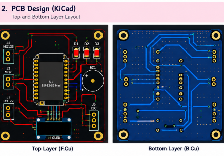
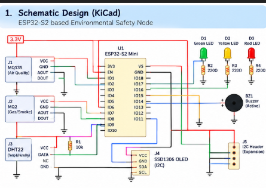
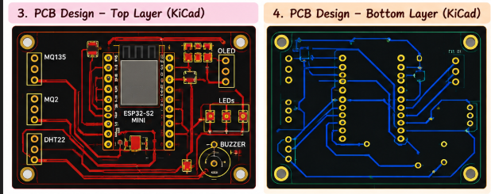
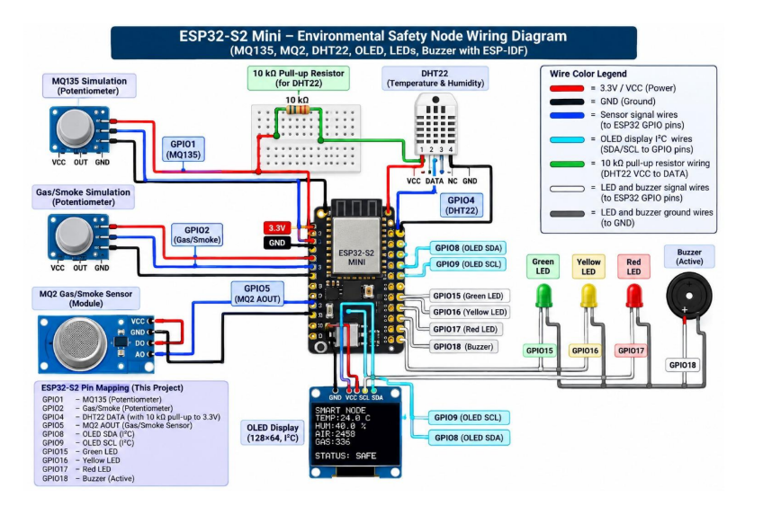

# ZenAlert — SIH26178 Early-Warning Dashboard Demo

A presentation-ready browser prototype for the ZenAlert environmental early-warning platform, with a FastAPI service, responsive dashboard, and focused sensor-node simulation.



## Hardware & PCB Design

ZenAlert features a custom 2-layer PCB designed in KiCad for an autonomous environmental safety and early-warning node powered by an ESP32-S2 microcontroller.

| PCB Layout (Top & Bottom Layers) | Schematic Design |
|---|---|
|  |  |

| Layer Routing Detail | Hardware Wiring & Simulation |
|---|---|
|  |  |

### PCB Specifications & Features
- **Microcontroller**: ESP32-S2 Mini
- **Board Dimensions**: 65 mm × 55 mm (2-layer FR4, 1.6 mm thickness)
- **Sensors Integrated**:
  - `MQ-135` Air Quality / Toxic Gas Sensor (GPIO1)
  - `MQ-2` Smoke & Combustible Gas Sensor (GPIO2)
  - `DHT22` Digital Temperature & Humidity Sensor (GPIO4 with 10kΩ pull-up)
- **Local Telemetry & Actuation**:
  - `SSD1306` 0.96" OLED Display (I2C: SDA GPIO8, SCL GPIO9)
  - Tri-color status indicators: Green (Safe, GPIO15), Yellow (Warning, GPIO16), Red (Critical, GPIO17)
  - High-decibel Active Alarm Buzzer (GPIO18)
  - Expansion Header for external I2C environmental modules
- **PCB Design & Fabrication Files**:
  - KiCad Schematic: [`pcb/zenalert_node.kicad_sch`](pcb/zenalert_node.kicad_sch)
  - KiCad PCB Layout: [`pcb/zenalert_node.kicad_pcb`](pcb/zenalert_node.kicad_pcb)
  - KiCad Project: [`pcb/zenalert_node.kicad_pro`](pcb/zenalert_node.kicad_pro)
  - Production Gerber Files: [`pcb/gerbers.zip`](pcb/gerbers.zip)
  - Bill of Materials: [`bom.csv`](bom.csv)


- Live Map control-room dashboard (MapLibre GL + OpenFreeMap vector tiles — no API key needed)
- Simulated environmental sensor telemetry
- Multi-modal confidence / severity display
- Incident Center with search
- Sensors & Air page
- Device Health page for 16 nodes
- Alert Composer + delivery log
- Analytics & Reports view
- Admin / thresholds page
- Standalone Sensor Node Prototype with live fire-event simulation (Three.js 3D scene)
- Dark / light mode
- English / Hindi toggle
- Online / Offline connection state
- Responsive layouts for desktop, laptop, tablet, and mobile

## Run Locally

1. Install the Python dependencies used by the backend.
2. Start the backend from the repository root:

   ```powershell
   uvicorn backend.main:app --reload --host 127.0.0.1 --port 8000
   ```

3. Open `http://127.0.0.1:8000/` for the landing page and `http://127.0.0.1:8000/app.html` for the dashboard.
4. Use the dashboard's **Prototype** page for the embedded simulation, or open `http://127.0.0.1:8000/simulation.html?v=5` for the focused standalone prototype.
5. The standalone prototype intentionally has no "Back to Site" or "Open Dashboard" actions. It is a focused sensor-node lab view containing only the simulation, sensor controls, status display, and pipeline. The dashboard embed provides the separate **Open Fullscreen** action when a larger view is needed.
6. In the dashboard, **LIVE** uses the FastAPI service and **DEMO** uses sample data. Use **EN | हिं** for the language toggle and the moon icon for theme changes.

### Prototype controls

The standalone sensor-node prototype starts in a safe state:

- **NORMAL** restores baseline telemetry and clears the camera panel.
- **FIRE TEST** runs the complete event pipeline: sensor anomaly, camera verification, AI fusion, local alarm, LoRa transmission, and dashboard notification.
- **CLEAR** returns the simulation to its initial safe state.

The prototype header is intentionally compact and contains no navigation links. It is designed to work at laptop and mobile widths. On smaller screens, the 3D scene appears first and the sensor controls follow below it; the pipeline wraps into readable rows instead of forcing horizontal scrolling.

### Final prototype UX

- The standalone page opens directly into the sensor-node simulation.
- Navigation back to the landing page and dashboard is intentionally omitted to avoid competing actions.
- The dashboard's Prototype route remains the entry point when the simulation needs to be viewed in context.
- The standalone simulation is safe by default and provides explicit **NORMAL**, **FIRE TEST**, and **CLEAR** controls.

## Deploy to Production (Render)

We deploy on **Render** as a single web service — FastAPI serves both the API and the static frontend.

1. Push this repository to GitHub.
2. Go to [Render Dashboard → Blueprints](https://dashboard.render.com/blueprints) → **New Blueprint Instance**.
3. Connect your GitHub repository — Render will detect `render.yaml` and create the service.
4. Set `FRONTEND_ORIGINS` to your Render URL (e.g. `https://zenalert-api.onrender.com`).
5. Wait for the build to finish. Your site is live at your Render URL.

See [DEPLOYMENT.md](DEPLOYMENT.md) for the full deployment guide, environment variables reference, verification checklist, and 3D map setup details.

## Map & 3D Setup — No API Keys Needed

| Component          | Library          | API Key? |
|--------------------|------------------|----------|
| Live Threat Map    | MapLibre GL JS   | ❌ No    |
| Base map tiles     | OpenFreeMap Dark (Vector) | ❌ No    |
| 3D Sensor Sim      | Three.js         | ❌ No    |

The map uses free OpenFreeMap dark vector tiles over MapLibre GL with 45° pitch for the 3D perspective. No API keys or accounts are required. See [DEPLOYMENT.md](DEPLOYMENT.md#3d-map-setup-maplibre-gl--openfreemap-tiles) for details on switching to other vector tiles (MapTiler, Stadia, Mapbox) if needed.

## Environment Setup

Copy `.env.example` to `.env` and fill in the values:

```bash
cp .env.example .env
```

See [.env.example](.env.example) for all available variables and documentation.

> **Note:** The current demo works with zero configuration. `.env` is only needed if you want to set custom CORS origins for production.

## Deployment Strategy & Scalability (Nainital Example)

Our deployment model scales cost-effectively from a single prototype to full district-wide coverage:

1. **Prototype (Bhowali Range):** 1 Gateway + 1 Node (~₹20,000) covering 5-10 km².
2. **Small Cluster:** 1 Gateway + 15 Nodes (~₹65K - 1.15L) covering 50-100 km².
3. **Priority Zones:** 8 Gateways + 80-160 Nodes (~₹5.2L - 9.2L) targeting 8 major fire-prone ranges (Naina, Kosi, etc.).
4. **Selective District Coverage:** 30-50 Gateways + 300-1000 Nodes (~₹19.5L - 57.5L) covering 10-30% of the district's 2,866 km² forest area.

## Architecture

The visual IA follows the PRD's specified dashboard pages and core features:
Live Map, Incident Center, Incident Detail, Sensors & Air Quality, Device Health, Alerts, Analytics, Admin, Public Alert View, and the Deployment Strategy page.

The map uses MapLibre GL JS with OpenFreeMap dark vector tiles; it can later be swapped for other vector tiles with a provider API key, while keeping the same UI shell.

## Backend integration points

The dashboard uses the FastAPI service when it is running and retains simulated fallback data for presentation. Replace or extend the API functions in `frontend/js/api.js` with:
- FastAPI REST calls
- FastAPI WebSocket/SSE for real-time events
- SQLite/PostgreSQL for telemetry and incidents
- MQTT/LoRa gateway data
- YOLOv8 / CNN-LSTM inference outputs
- Local image evidence from the gateway
- Alert gateways (SMS/push/siren/CAP feed)
