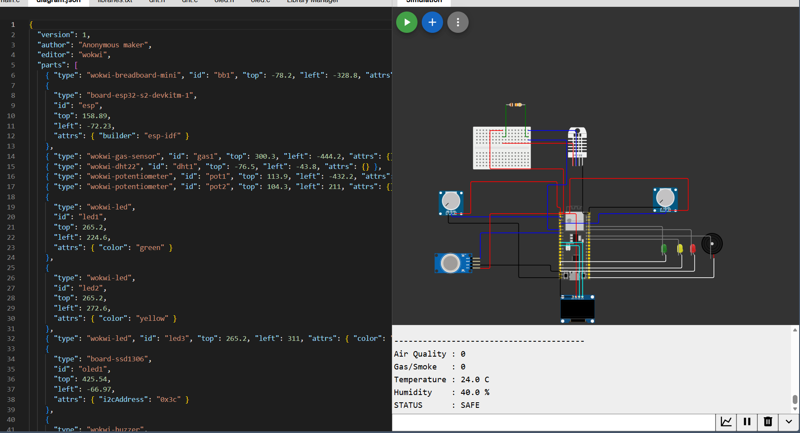

# ZenAlert — Environmental Safety Node PCB

Custom 2-layer PCB designed in KiCad for the ZenAlert environmental monitoring and early-warning node.

## Overview

The ZenAlert sensor node continuously monitors ambient environmental parameters to detect smoke, hazardous gases, and rapid heat spikes indicative of early forest or industrial fires. It features local alerting (tri-color LEDs and active buzzer) as well as an OLED display for immediate on-site diagnostics.

| Schematic Design | PCB Layer Routing |
|---|---|
|  |  |

| Hardware Wiring Diagram | Wokwi Circuit Simulation |
|---|---|
|  |  |

---

## Technical Specifications

- **Controller**: ESP32-S2 Mini (DevKitM-1 pin-compatible footprint)
- **Board Dimensions**: 65 mm × 55 mm
- **Layer Count**: 2 Layers (Top Layer F.Cu, Bottom Layer B.Cu)
- **PCB Thickness**: 1.6 mm FR4
- **Copper Weight**: 1 oz (35 µm)
- **Surface Finish**: HASL with lead or ENIG
- **Silkscreen**: White over Black / Blue soldermask
- **Mounting**: 4x M3 screw holes (3.2 mm diameter) at board corners

---

## Pin Mapping & Interfacing

| Subsystem / Component | Part | Pin / Net | Description |
|---|---|---|---|
| Air Quality Sensor | MQ-135 Module | `GPIO1` | Analog output for toxic gas & air quality |
| Smoke / Gas Sensor | MQ-2 Module | `GPIO2` | Analog output for combustible gas & smoke |
| Temp & Humidity | DHT22 | `GPIO4` | 1-Wire digital signal with 10kΩ pull-up |
| Status Indicator 1 | Green LED | `GPIO15` | Normal safe operating condition |
| Status Indicator 2 | Yellow LED | `GPIO16` | Warning / elevated threshold detected |
| Status Indicator 3 | Red LED | `GPIO17` | Critical alarm triggered |
| Acoustic Alert | Active Buzzer | `GPIO18` | High-decibel audible alarm |
| Local Display | SSD1306 0.96" OLED | `GPIO8` (SDA), `GPIO9` (SCL) | I2C display for telemetry values |
| Auxiliary Expansion | 4-Pin Header | `3V3`, `GND`, `SDA`, `SCL` | External I2C sensor node expansion |

---

## Files in this Directory

- [`zenalert_node.kicad_pro`](zenalert_node.kicad_pro) — KiCad project configuration
- [`zenalert_node.kicad_sch`](zenalert_node.kicad_sch) — Complete schematic design
- [`zenalert_node.kicad_pcb`](zenalert_node.kicad_pcb) — 2-layer PCB layout and routing
- [`gerbers.zip`](gerbers.zip) — Production-ready Gerber (RS-274X) & Excellon drill archive for fabrication (JLCPCB / PCBWay compatible)
- [`gerber/`](gerber/) — Uncompressed individual Gerber layer files
- [`kicad_pcb_layout.png`](kicad_pcb_layout.png) — Top & bottom 2D render of PCB
- [`kicad_schematic.png`](kicad_schematic.png) — KiCad schematic diagram
- [`pcb_layers_routing.png`](pcb_layers_routing.png) — Top and bottom copper trace visualization
- [`wiring_diagram.png`](wiring_diagram.png) — Breadboard wiring diagram
- [`wokwi_simulation.png`](wokwi_simulation.png) — Circuit simulation screenshot
